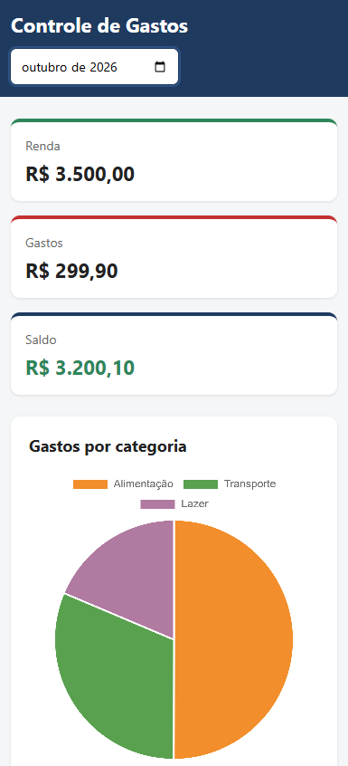

# Controle de Gastos

Aplicação web para controlar gastos mensais e planejar objetivos financeiros. Você cadastra rendas e despesas, o sistema **categoriza os gastos automaticamente**, mostra um **gráfico de pizza** com a distribuição do mês e calcula **quanto guardar por mês** para alcançar suas metas (uma viagem, uma moto 0 km...).



## Funcionalidades

- **Renda e gastos:** cadastro de entradas e saídas, com filtro por mês.
- **Edição pela interface:** qualquer transação pode ser editada ou apagada direto na lista do mês.
- **Categorização automática:** a descrição do gasto (ex.: "Uber", "Netflix", "Mercado") é comparada com palavras-chave e a categoria é definida sozinha. Se nenhuma palavra bater, vai para "Outros". A categoria também pode ser informada manualmente.
- **Resumo do mês:** total de renda, total de gastos, saldo e gráfico de pizza por categoria.
- **Gastos fixos recorrentes:** transações marcadas como fixas (aluguel, assinaturas, salário) podem ser geradas no mês seguinte com um clique, sem duplicar. Também é possível parar a repetição.
- **Metas financeiras:** define valor alvo e prazo, registra quanto já foi guardado e calcula quanto guardar por mês, com barra de progresso.
- **API documentada:** documentação interativa gerada automaticamente em `/docs`.

## Tecnologias

- **Python** e **FastAPI** (API)
- **SQLAlchemy** e **SQLite** (banco de dados)
- **Pydantic** (validação dos dados)
- **HTML, CSS e JavaScript** (interface)
- **Chart.js** (gráfico de pizza)
- **pytest** (testes automatizados)

## Como rodar (Windows)

Requisitos: Python 3.11 ou superior e Git.

```
git clone https://github.com/guifelix1104/controle-gastos.git
cd controle-gastos
python -m venv venv
venv\Scripts\activate
pip install -r requirements.txt
uvicorn app.main:app --reload
```

Depois, acesse:

- Aplicação: http://127.0.0.1:8000
- Documentação da API: http://127.0.0.1:8000/docs

O banco de dados (`gastos.db`) é criado automaticamente na primeira execução, já com as categorias padrão.

## Testes

Os testes usam `pytest` e um banco de dados temporário em memória (não tocam no `gastos.db`). Com o ambiente virtual ativo:

```
pytest
```

Eles cobrem a categorização automática, o CRUD de transações, os gastos fixos recorrentes, o resumo mensal e o cálculo das metas.

## Estrutura do projeto

```
controle-gastos/
├── app/
│   ├── main.py            # criação do app e rotas principais
│   ├── database.py        # conexão com o banco
│   ├── models.py          # tabelas (Categoria, Transacao, Meta)
│   ├── schemas.py         # validação de entrada e saída
│   ├── seed.py            # categorias padrão
│   ├── categorizador.py   # lógica da categorização automática
│   ├── routers/
│   │   ├── transacoes.py
│   │   ├── categorias.py
│   │   ├── resumo.py
│   │   └── metas.py
│   └── static/
│       ├── index.html
│       ├── style.css
│       └── app.js
├── tests/
│   ├── conftest.py        # banco temporário e cliente de teste
│   ├── test_categorizador.py
│   ├── test_transacoes.py
│   ├── test_resumo.py
│   └── test_metas.py
├── screenshots/
├── pytest.ini
├── requirements.txt
└── README.md
```

## Principais endpoints

| Método | Rota | Descrição |
|---|---|---|
| POST | `/transacoes/` | Cria uma transação (categoria automática se não informada) |
| GET | `/transacoes/?mes=AAAA-MM` | Lista as transações do mês |
| GET | `/transacoes/{id}` | Busca uma transação |
| PUT | `/transacoes/{id}` | Edita uma transação |
| PATCH | `/transacoes/{id}/fixa` | Liga ou desliga a repetição mensal |
| DELETE | `/transacoes/{id}` | Apaga uma transação |
| POST | `/transacoes/gerar-fixas?mes=AAAA-MM` | Gera os gastos fixos do mês |
| GET | `/resumo/?mes=AAAA-MM` | Renda, gastos, saldo e gastos por categoria |
| GET | `/categorias/` | Lista as categorias |
| POST | `/metas/` | Cria uma meta |
| GET | `/metas/` | Lista as metas com progresso e valor mensal sugerido |
| POST | `/metas/{id}/depositar` | Registra um valor guardado na meta |
| DELETE | `/metas/{id}` | Apaga uma meta |

## Como funciona a categorização

Cada categoria tem uma lista de palavras-chave. A descrição do gasto é normalizada (minúsculas, sem acentos) e comparada com todas as palavras. Quando mais de uma bate, vence a **palavra mais longa**: "gasolina" (Transporte) tem prioridade sobre "gas" (Moradia).

## Próximos passos

- [x] Editar transações pela interface
- [x] Testes automatizados
- [ ] Login e múltiplos usuários
- [ ] Importar extrato bancário (CSV)
- [ ] Categorias e palavras-chave personalizadas
- [ ] Valores monetários com `Decimal` ou centavos
- [ ] Deploy online

## Autor

Desenvolvido por **Guilherme Felix**, estudante de Análise e Desenvolvimento de Sistemas, como projeto de aprendizado.

GitHub: [@guifelix1104](https://github.com/guifelix1104)